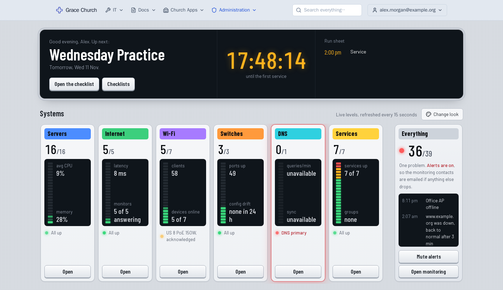
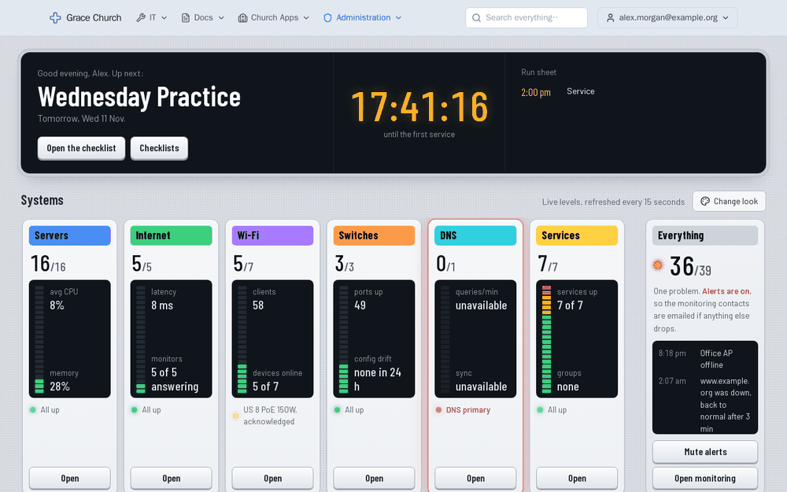
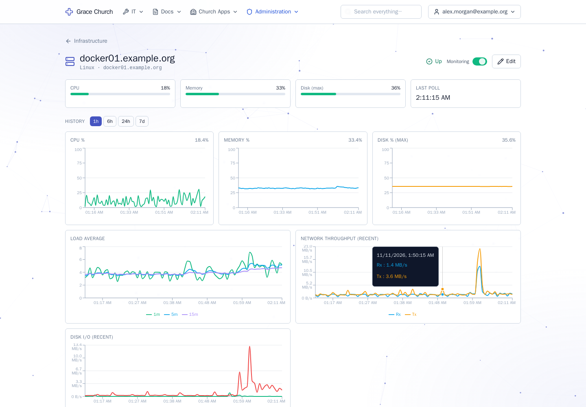
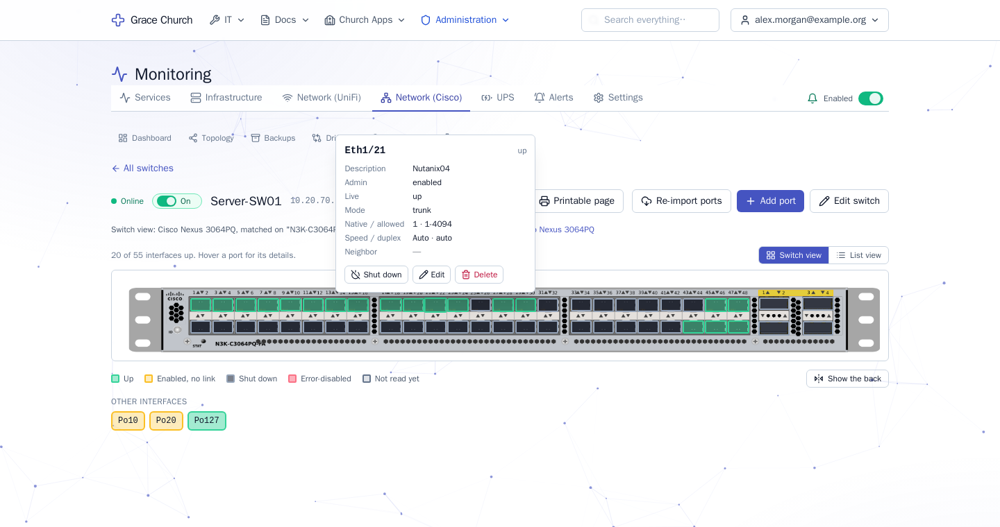
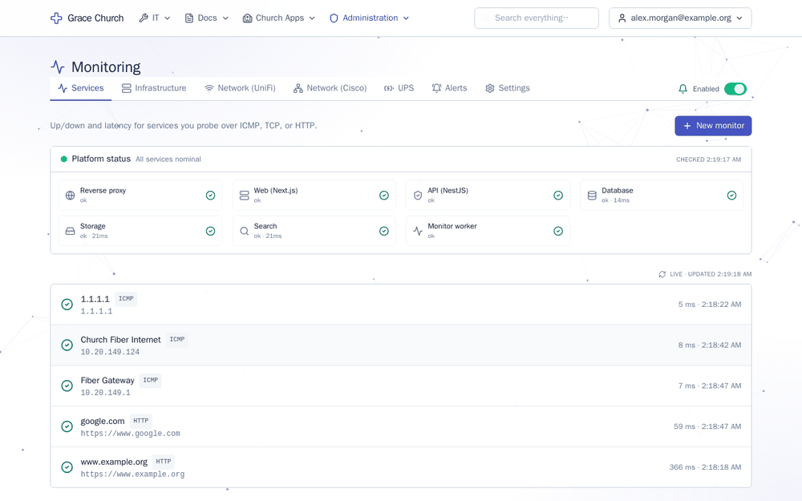

# Lampstand

> "Nor do people light a lamp and put it under a basket, but on a stand, and it gives light to
> all in the house." — Matthew 5:15 (ESV)
>
> "...the seven lampstands are the seven churches." — Revelation 1:20 (ESV)

**Why the name.** A lamp is only useful if it is set where people can see by it. That is the
job of this project: to put the state of a church's technology on a stand where the whole
team can see it, so the lights stay on and nothing sits hidden under a basket. Tickets,
runbooks, monitoring and the rest exist so that a few volunteers can keep the equipment
working, and everyone else can simply worship, learn and gather by its light. In Revelation
the churches themselves are lampstands: the thing that holds the light up, not the light.
That is the role of this software too, a supporting one.

Lampstand is a self-hosted, modular dashboard for a single church. One place for support tickets,
the wiki, notes, monitoring, network and DNS, printer status, ProPresenter control, Planning Center,
volunteer checklists, livestream checks, TV signage, an optional AI assistant, and the rest.

> **Status:** everything in the table below is built and tested on the development stack. The
> deliberately deferred part is Phase 4, bespoke church-specific modules (volunteer scheduling,
> kids check-in, service planning), which will not start without an explicit decision. Signage was
> built against simulated Raspberry Pis only (no real Pi or TV has run it yet), and the Assistant has not yet been run against a real model. See
> [CLAUDE.md](./CLAUDE.md) § Roadmap for the detail.

## Screenshots

Shown in your browser's light or dark setting. These come from the development stack with names, addresses and hostnames replaced by examples.

### Home page

Every person picks a look for the home page. This is **Front of House**, the console view for a booth screen or the person on duty: the service countdown, a strip per area (servers, internet, Wi-Fi, switches, DNS, services) with live meters, and whatever currently needs someone.

<picture>
  <source media="(prefers-color-scheme: dark)" srcset="docs/screenshots/home-front-of-house-dark.png">
  
</picture>

There are six looks (Front of House, Glass, Nave, Toward Sunday, Start page and the draggable Tiles), all in light and dark, all reading the same data:

<picture>
  <source media="(prefers-color-scheme: dark)" srcset="docs/screenshots/home-looks-dark.gif">
  
</picture>

### Monitoring

Hosts are read over SSH with no agent: CPU, memory, disk, load, network and disk throughput, containers and pending updates, with threshold alerts that open incidents.

<picture>
  <source media="(prefers-color-scheme: dark)" srcset="docs/screenshots/monitoring-host-dark.png">
  
</picture>

Cisco switches are shown as a picture of the real front panel, with each port coloured by state and a details card on hover. The pictures are device profiles an admin can import from a vendor stencil.

<picture>
  <source media="(prefers-color-scheme: dark)" srcset="docs/screenshots/monitoring-switch-dark.png">
  
</picture>

A short tour of the Monitoring section: service probes, a host's charts, UniFi devices, and a switch's ports and back panel.

<picture>
  <source media="(prefers-color-scheme: dark)" srcset="docs/screenshots/monitoring-tour-dark.gif">
  
</picture>

## What's in here

Each module has its own settings inside it (for example `/signage/settings`, `/tickets/settings`),
edited by that module's admins. **Admin** is only for site administrators and site-wide settings.

| Area | What it does |
|---|---|
| Sign-in and access | Google, Microsoft Entra and local accounts, optional or required TOTP, external-account approval for volunteers, per-browser sessions and sign-out, personal API tokens |
| Users, groups and tiers | Groups are granted a tier (`user`, `moderator`, `admin`) per module; the permission matrix, an audit log of every change, a security overview |
| Home page | Six looks (Tiles, Start page, Nave, Toward Sunday, Glass, Front of House), each person picks theirs; light and dark theme; installable PWA; command palette (Ctrl+K) |
| Helpdesk | Tickets, categories, SLA targets with warnings, a "waiting on requester" status, saved replies, tickets from a mailbox |
| Wiki | Markdown pages with attachments, folders, page-level access, history and diffs, templates, "linked from", review reminders, import from .docx / .pdf / .txt |
| Notes | Personal sticky-note board |
| Notifications | In-app, email, web push, quiet hours and a daily summary |
| Search, @mentions, tags, activity, saved views | One full-text search across tickets, notes, wiki and the monitoring data |
| Monitoring | Uptime probes (including AV devices), infrastructure hosts and service templates, UniFi, Cisco switches (config backups, drift, VLANs), UPS, incidents with acknowledge and escalation, alert channels, a status page |
| IPAM, DNS, cabinets, device profiles, renewals | Subnet scanner, Technitium DNS with IPAM sync, rack elevations and printable port sheets, switch pictures, licence and domain expiry reminders |
| Equipment and rooms | Inventory, check-out, labels, CSV import, shared rooms list |
| Printers | SNMP status, toner and trays |
| ProPresenter, Planning Center | Status and control (ProPresenter), read-only plans and people (Planning Center) |
| Checklists | Per-event task lists, stations, recurring services, shared-screen completion |
| Livestreams | Checks that a stream is live and healthy, with alerts |
| Signage | TV screens driven by Raspberry Pis: media, playlists, schedules, events, TV power |
| Assistant (off by default) | A chat answered by a model you choose, read-only and as the signed-in person |
| MCP server | Lets an agent such as Claude read and, within limits, update the site through personal API tokens |
| Backups and restore | Scheduled and on-demand, offsite copies, verified, selective restore with a change report |
| Clustering | Several app nodes behind a load balancer; the database carries coordination, no Redis |

## Architecture in one paragraph

Next.js 15 frontend + NestJS backend + a Postgres-wire database (CockroachDB bundled, or your own
CockroachDB or YugabyteDB) + an S3-compatible object store (Garage bundled, or your own) + Meilisearch,
all behind Caddy on a single host port (default **:8100**,
HTTP only — terminate HTTPS upstream). Auth.js handles Google and Microsoft Entra SSO
plus local accounts with optional/required TOTP; OAuth providers are configured at
runtime in the database, not in env. Access control is group-based with per-module
tiers (`user` / `moderator` / `admin`) that resolve to the permission strings the API
guards on. Every mutating action lands in the `audit_log` table via a NestJS
interceptor. Realtime updates push over Socket.io; between app nodes they travel through the database.

## Quick start

**[QUICKSTART.md](./QUICKSTART.md)** goes from a bare Linux host to a signed-in dashboard
in six steps, including choosing a database.

**Easiest: the guided installer.** It asks a few questions (one server or several, which database,
which file storage, which port), writes `.env`, starts everything and prints the address to open:

```bash
git clone https://github.com/paintballrefjosh/lampstand lampstand
cd lampstand
./install.sh
```

Or by hand, with the default bundled database:

```bash
git clone https://github.com/paintballrefjosh/lampstand lampstand
cd lampstand
make up        # generates .env with a random AUTH_SECRET; creates ./data/ bind mounts
make migrate   # applies DB migrations
make seed      # seeds default groups + per-module access and the bootstrap admin (user "admin", password "admin")
```

Then open `http://<server>:8100` and sign in with **admin / admin**. You'll be forced to set
a new password on first login. After that, settings live in the database, not in files: site-wide
ones (sign-in, Google/Microsoft OAuth, SMTP, backups) at `/admin/settings`, and each module's own
settings on that module's Settings page.

Persistent data is bind-mounted into `./data/<service>/` so backing up the whole stack is a
`tar -czf backup.tgz data/ .env` away. Full setup details and Google Workspace integration are in
[INSTALL.md](./INSTALL.md).

> **`AUTH_SECRET` is the one secret that matters.** Set in `.env` (shared identically by
> `web` and `api`), it (1) signs/encrypts the Auth.js session cookie, (2) lets the API
> validate that cookie on every request and WebSocket, (3) derives the web→api internal-call
> token, and (4) **encrypts secret settings — SMTP password, OAuth secrets — at rest in the
> DB**. `make up` generates a random one. Two consequences: **back up `.env` together with
> `data/`** (a data-only backup can't be decrypted), and **don't rotate it casually** —
> changing it logs everyone out and makes stored secrets unreadable, so you'd re-enter them
> at `/admin/settings`.

## Deployment

Only Caddy is exposed to the host. Everything else is on the internal compose network.
The upstream load balancer terminates TLS and forwards HTTP to host port **:8100**.

```bash
make prod-up   # same as: scripts/compose.sh --prod up -d --build
```

Prod compose runs a 3-node CockroachDB cluster and expects production env vars
(see [INSTALL.md](./INSTALL.md#production)). Outbound mail uses whatever SMTP server
you configure in `/admin/settings` (the same in dev and prod). For several machines behind a load
balancer, see [Deployment shapes](./INSTALL.md#deployment-shapes-single-node-and-multi-node).

## Regression testing

After any change, run the regression suite. It boots nothing — it expects the stack to
be running — and exercises the live services and HTTP endpoints (smoke) plus the core
feature flows in a browser (Playwright e2e).

```bash
make regression
# equivalent: pnpm regression
```

## Project docs

- [CLAUDE.md](./CLAUDE.md) — architecture, conventions, "things to never do", roadmap
- [QUICKSTART.md](./QUICKSTART.md) — shortest path to a running dashboard
- [INSTALL.md](./INSTALL.md) — full setup, upgrades, backups, clustering, Google Workspace
- [docs/](./docs) — design notes and decisions per feature: [module settings](./docs/module-settings.md),
  [multi-node](./docs/multi-node.md), [assistant](./docs/assistant.md), [MCP](./docs/mcp.md),
  [signage](./docs/signage.md), [service monitoring](./docs/service-monitoring.md),
  [home looks](./docs/dashboard-themes.md) and others

## License

To be decided. Default for now: no public redistribution; private/internal use only.
